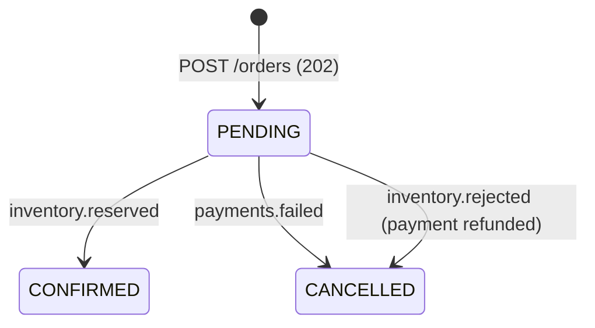

# Event Catalogue

All events are JSON, keyed by `orderId` (per-order ordering). Producers use `acks=all` and idempotence. Consumers retry 3x, then publish to `<topic>.DLT`.

| Topic | Producer | Consumers | Payload |
|---|---|---|---|
| `orders.created` | Order | Payment | `orderId, customerId, sku, quantity, amount` |
| `payments.completed` | Payment | Inventory | `orderId, sku, quantity, amount` |
| `payments.failed` | Payment | Order, Notification | `orderId, reason` |
| `inventory.reserved` | Inventory | Order, Notification | `orderId` |
| `inventory.rejected` | Inventory | Order, Payment (refund), Notification | `orderId, reason` |
| `shipments.created` (Planned) | Shipping | Order, Notification | `orderId, trackingId` |

Source: `Topics.java` and `Events.java` in the `common` module of the demo.

## Order status

