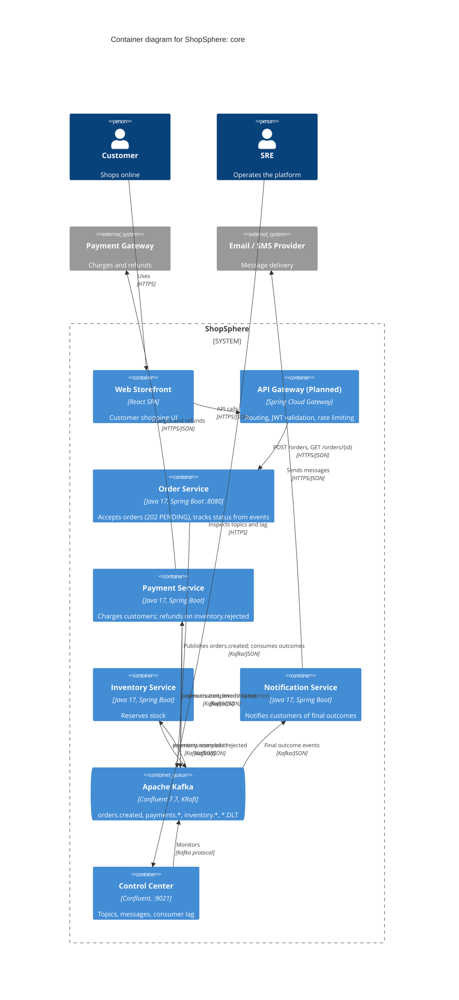
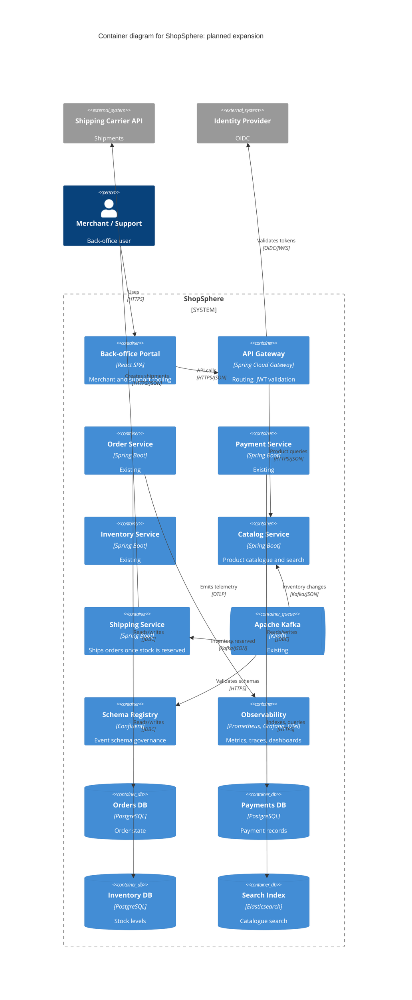

# Level 2: Containers

Split in two for readability. Elements marked **(Planned)** are target-state and not in the current Kafka demo.

## 2a. Core containers (current demo plus entry points)

The shared `common` Maven module (event records, topic names, Kafka config with topic creation, 3x retry, dead-letter topics, `ErrorHandlingDeserializer`) is compiled into the four services and omitted here.

## 2b. Planned expansion (target state)

