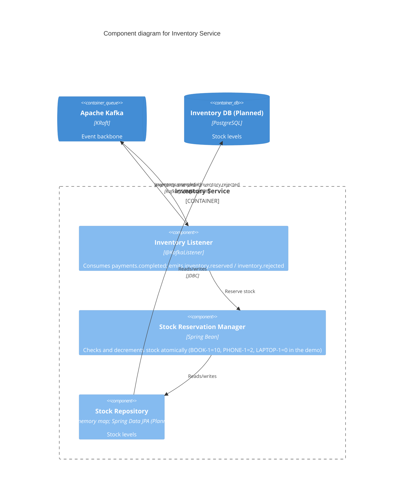

# Level 3: Components, Inventory Service

## Notification Service (summary)

Single `@KafkaListener` component consuming final outcome events (`inventory.reserved`, `payments.failed`, `inventory.rejected`) and logging a simulated email. Planned: template renderer and a provider adapter calling the Email/SMS provider.
