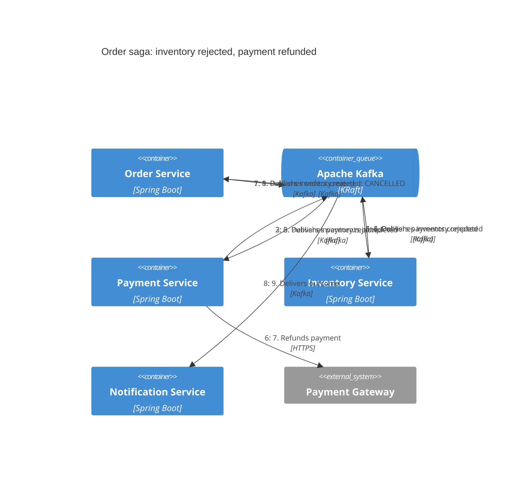
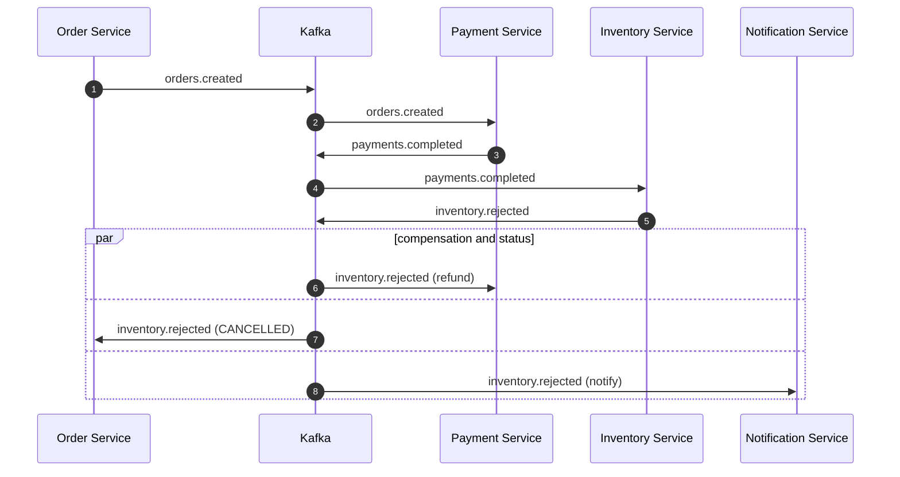
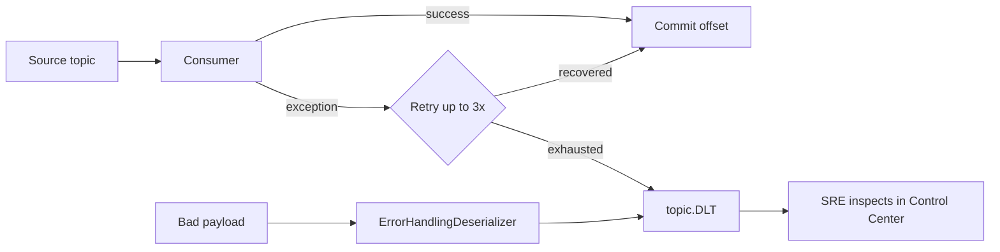

# Dynamic: Inventory rejected, refund (compensation)

Payment succeeded but stock is unavailable (e.g. `LAPTOP-1`). Payment Service listens to `inventory.rejected` and refunds.

## Failure handling (dead-letter)

