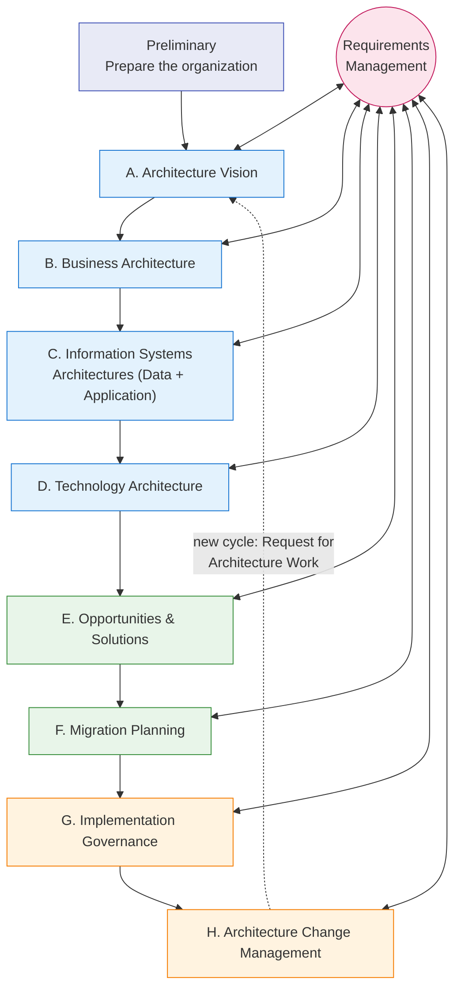
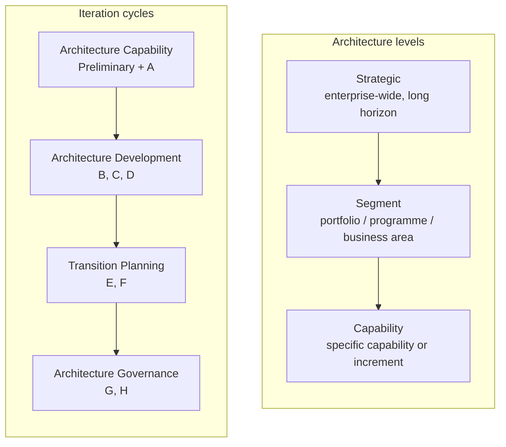
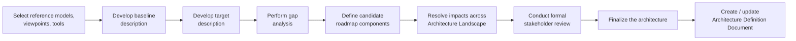
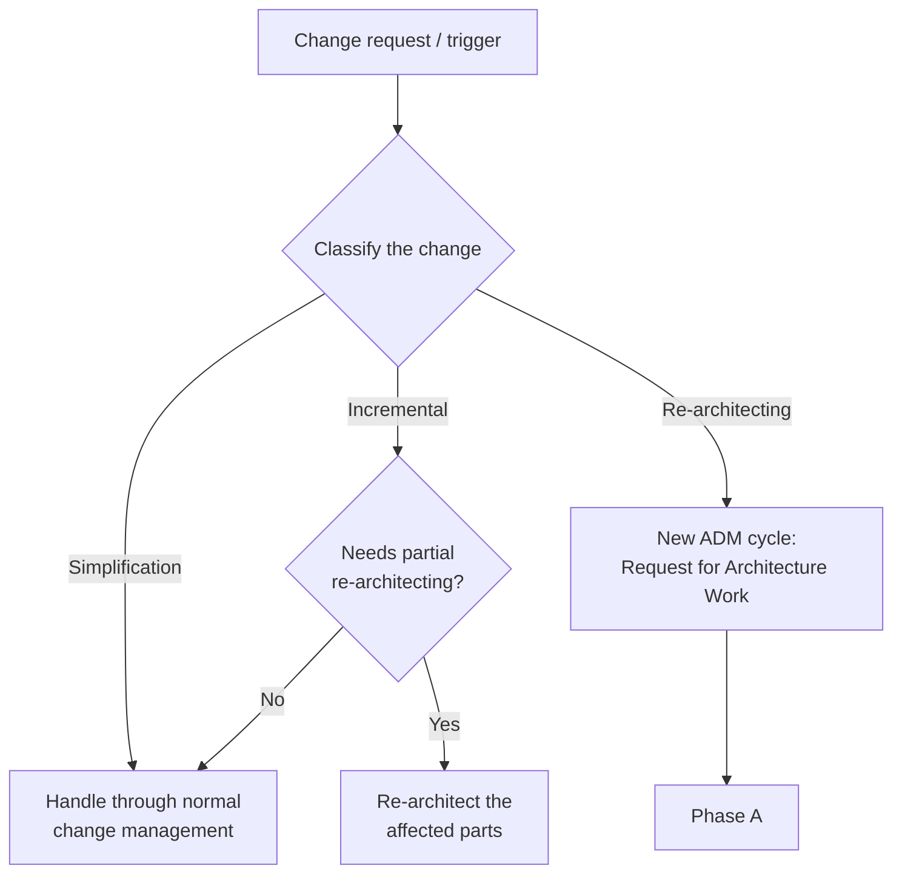
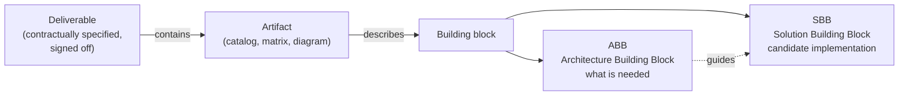
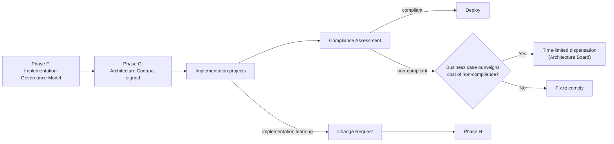
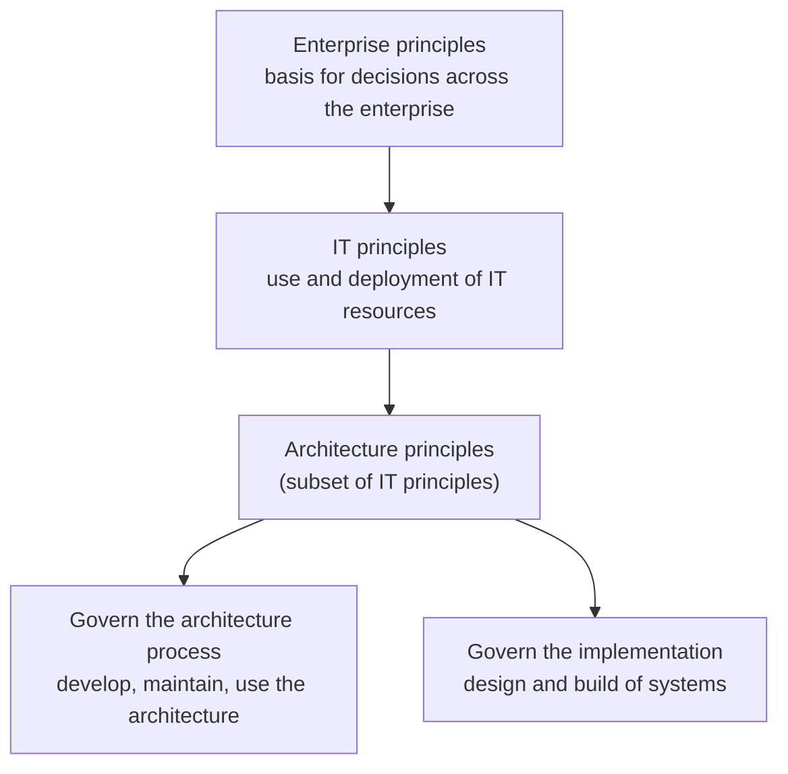
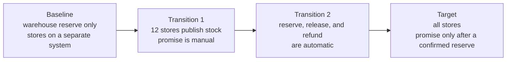

# TOGAF ADM Principles – Summary

A study summary of the **Architecture Development Method (ADM)** in the TOGAF Standard and the principles that shape how it is used. Diagrams are Mermaid and render on GitHub. A full pass through one initiative is in [section 8](#8-worked-example-shopsphere-click-and-collect).

> TOGAF® is a registered trademark of The Open Group. This is an independent paraphrase for learning, not a reproduction of the standard. Use the [TOGAF Standard](https://www.opengroup.org/togaf) as the primary source.

---

## 1. What "ADM principles" means

"ADM principles" is not one official list in the standard. It covers three related things:

| Layer | Question it answers | Section |
|---|---|---|
| **ADM guiding principles** – how the method is meant to be used | *How do I apply the ADM?* | [section 3](#3-adm-guiding-principles) |
| **Architecture Principles** – rules the architecture must follow (set in the Preliminary Phase) | *What rules govern our architecture decisions?* | [section 6](#6-architecture-principles-the-rules-the-adm-produces-and-uses) |
| **Phase logic** – what each phase achieves | *What happens when?* | [section 4](#4-the-phases-at-a-glance) |

The ADM guiding principles in section 3 are a synthesis of themes that recur across the standard (iteration, tailoring, requirements-driven, stakeholder-driven, governance) rather than a verbatim official list.

---

## 2. The ADM cycle

The cycle is **not a waterfall**. Requirements Management sits at the center because every phase consumes and produces requirements.

---

## 3. ADM guiding principles

| Principle | What it means in practice |
|---|---|
| **Iterative** | The ADM is applied repeatedly: across the whole cycle, between phases, and within a phase. Phases are not signed off once and left. |
| **Tailorable** | The ADM is a template. Decide which steps, artifacts and deliverables the organization needs, and document that in the Preliminary Phase. Adopting every artifact untailored is a common failure. |
| **Requirements-driven** | All phases produce and consume requirements. Requirements Management records them and assesses the impact of changes. It does **not** prioritize or resolve requirements itself. That happens inside the owning phase. |
| **Stakeholder-driven** | Stakeholders and their *concerns* (not just their names) drive scope and viewpoints, starting in Phase A. |
| **Business-first** | The domain order is Business, then Data and Application, then Technology. Technology is chosen for what the business and applications need. |
| **Governed** | Implementation is governed through Architecture Contracts and compliance reviews (Phase G). The Architecture Board arbitrates and grants time-limited dispensations. |
| **Reuse-oriented** | Assets live in the Architecture Repository and are classified on the Enterprise Continuum. Architecture Building Blocks stay stable while Solution Building Blocks change. |

### How to adapt the ADM

- **Baseline first** suits a complex or poorly understood current state. **Target first** suits a well-understood current state.
- **Partitioning** splits a large enterprise's architecture work into pieces with clear ownership, so teams can run separate cycles without contradicting each other.
- A strategic cycle typically spawns several segment and capability cycles.

---

## 4. The phases at a glance

| Phase | Purpose | Key output |
|---|---|---|
| **Preliminary** | Establish the architecture capability, tailor the framework, set principles and governance | Tailored Architecture Framework; **Architecture Principles** |
| **A. Architecture Vision** | Scope, stakeholders and concerns, baseline and target sketch, business value, approval | Approved **Statement of Architecture Work**; Architecture Vision |
| **B. Business Architecture** | Baseline and target business architecture; gap analysis | Business sections of the Architecture Definition Document |
| **C. Information Systems** | Data and application architecture, in either order | Data and application sections of the Architecture Definition Document and Architecture Requirements Specification |
| **D. Technology** | Technology platforms hosting the applications and data | Technology sections; candidate roadmap components |
| **E. Opportunities & Solutions** | Consolidate gaps, define work packages and Transition Architectures | First complete Architecture Roadmap |
| **F. Migration Planning** | Prioritize and sequence work by value, cost and risk with portfolio owners | Finalized Implementation and Migration Plan; Implementation Governance Model |
| **G. Implementation Governance** | Ensure projects build what was architected | Architecture Contracts; Compliance Assessments |
| **H. Architecture Change Management** | Keep the architecture fit for purpose; decide when to start a new cycle | Change Requests; new Request for Architecture Work |
| **Requirements Management** | Continuously store requirements and assess change impact | Requirements Impact Assessment |

### Steps shared by Phases B, C and D

Gap analysis therefore happens three times (once per domain). Phase E consolidates the results.

### Phase H change triage

---

## 5. Architecture content and governance

**Enterprise Continuum** (generic to specific):

| Position | Architecture Continuum | Solutions Continuum |
|---|---|---|
| Most generic | Foundation Architecture | Foundation Solutions |
| Shared across systems | Common Systems Architectures | Common Systems Solutions |
| Sector-specific | Industry Architectures | Industry Solutions |
| Most specific | Organization-Specific Architectures | Organization-Specific Solutions |

**Architecture Repository** parts: Architecture Metamodel, Architecture Capability, Architecture Landscape, Standards Library, Reference Library, Governance Repository, Architecture Requirements Repository, Solutions Landscape. (Older TOGAF 9.x notes call two of these the "Standards Information Base" and "Governance Log".)

---

## 6. Architecture Principles: the rules the ADM produces and uses

Architecture Principles are established in the **Preliminary Phase**, refined in **Phase A**, and used as decision criteria in every later phase and in compliance reviews.

### Principle hierarchy

### Inputs that shape them

Architecture Principles are typically developed by the Chief Architect with the CIO, the Architecture Board and key business stakeholders, and each should trace back to business objectives and architecture drivers. They are shaped by:

- **Enterprise mission and plans** – mission, strategy and organizational infrastructure
- **Strategic initiatives** – SWOT profile and enterprise-wide improvement programs
- **External constraints** – market factors, customer expectations and legislation
- **Current systems and technology** – deployed information resources, policies and procedures
- **Industry trends** – technology availability, cost and established best practices

### Five qualities of a good principle set

| Quality | Meaning |
|---|---|
| **Understandable** | Quickly grasped across the organization; intent is unambiguous. |
| **Robust** | Precise enough to support consistent decisions in contested situations and to create enforceable standards. |
| **Complete** | Covers every situation that matters for managing information and technology. |
| **Consistent** | Principles can be balanced against each other without contradiction. |
| **Stable** | Enduring, with a defined amendment process for adding, changing or removing principles. |

### Principle template

| Element | Guidance |
|---|---|
| **Name** | Memorable, captures the essence of the rule, mentions no specific technology. Avoid vague words such as "support", "open", "consider". |
| **Statement** | Succinct, unambiguous statement of the rule. |
| **Rationale** | Business benefits in business terms; relationship to other principles; which principle takes precedence when they conflict. |
| **Implications** | Resources, costs and tasks for business and IT. Answers "How does this affect me?" |

### Example

| Element | Example |
|---|---|
| **Name** | Data is shared |
| **Statement** | Users have access to the data necessary to perform their duties; therefore, data is shared across enterprise functions and organizations. |
| **Rationale** | Timely access to accurate data is essential to improving the quality and efficiency of decision-making. |
| **Implications** | A common data model and data-management policy are needed; ownership and stewardship must be defined. |

This example is illustrative, written to the template. The standard's own example sets include principles such as data being shared and defined consistently, and applications being independent of the underlying technology.

---

## 7. Common mistakes

| Area | Mistake |
|---|---|
| Preliminary | Adopting the ADM untailored and producing every artifact. |
| Phase A | Confusing the Architecture Vision with the Statement of Architecture Work. The sponsor signs the latter. |
| Phase B | Modeling the org chart instead of capabilities and value streams. |
| Phase C | Assuming data must always precede applications (or the reverse). Either order is valid. |
| Phase D | Starting with technology and retrofitting a business case. |
| Phase E | Treating it as procurement rather than sequencing change the business can absorb. |
| Phase F | Building the plan inside the architecture team without the portfolio owners. |
| Phase G | Architects leaving after Phase F, so implementation ignores the architecture. |
| Phase H | Reviewing every ticket, or not running Phase H at all. |
| Requirements Mgmt | Expecting it to prioritize or resolve requirements. It records them and assesses impact. |

---

## 8. Worked example: ShopSphere click-and-collect

[ShopSphere](../c4-model/shopsphere/README.md) already takes an online order through an event-driven saga: order, payment, inventory, and notification. Stores still reserve stock in a separate system. Web and store counts disagree, so the site cannot promise same-day collection, and a failed store reservation does not always reverse the payment.

The sponsor is the head of retail operations. The request is to offer same-day click-and-collect in 12 pilot stores, then all stores, without replacing the checkout saga or the payment provider.

| Phase | What this initiative does | Output for this case |
|---|---|---|
| **Preliminary** | The architecture capability already exists, so this pass only confirms the tailored method: vision, four domain views, roadmap, and contracts. No organization redesign. Principles in force: one definition of inventory, checkout continues if a store system is down, and new channels reuse the existing saga rather than adding another integration stack. | Confirmed principles and a tailored artifact list |
| **A. Architecture Vision** | Stakeholders and concerns: retail operations (stock accuracy), customers (a promise the store can keep), finance (no charge left after a failed reserve), store managers (handover workload), platform team (saga reliability). Scope is the pilot, then a rollout. Out of scope: a new payment provider and a new point-of-sale system. | Approved Statement of Architecture Work; vision of "promise only what a store can fulfill" |
| **B. Business Architecture** | Baseline value stream is browse, pay, reserve warehouse stock, notify. The gap is reserve store stock, promise a collection window, and hand the order over in store. The new capability is **Fulfill from store**, owned by retail operations. | Business gap: no store-fulfillment capability |
| **C. Information Systems** | Data and application work proceed together because the reservation event already exists. New data: store inventory position, collection promise, reservation result. Application change: extend inventory, add a store adapter, and record collection state on the order. | Gaps: no store-inventory event; no collection state |
| **D. Technology** | Reuse the current broker and services. Pilot stores connect through one adapter. Stores outside the pilot stay on the warehouse-only path. | Technology gap: store adapter, not a new platform |
| **E. Opportunities and Solutions** | Work packages: store inventory feed, reservation extension, collection promise, refund-on-reject, pilot rollout. Grouped into the two transition states above. Build the adapter; buy nothing new; reuse the saga. | Roadmap and the two Transition Architectures |
| **F. Migration Planning** | Portfolio owners sequence refund-on-reject before expanding past the pilot. A wrong promise costs more than a late rollout. Governance reviews are required when the saga contract changes. | Funded plan; Implementation Governance Model |
| **G. Implementation Governance** | The contract requires an idempotent refund when inventory rejects the reserve. A compliance review finds the pilot adapter writing stock outside the shared model. The Architecture Board grants a 90-day dispensation, then the adapter must comply. | Signed contract; one time-limited dispensation |
| **H. Architecture Change Management** | A second store system that fits the adapter is a simplification. A request to promise collection before payment conflicts with the finance concern and is re-architecting, so it starts a new cycle. | Triage, not a ticket-by-ticket review |

Requirements Management carries three requirements through every phase: shared store inventory, no charge without a reversible reservation, and a collection promise of at most two hours. When the "promise before payment" request appears, the impact assessment shows it breaks the second requirement. That is why Phase H starts a new cycle instead of patching the contract in Phase G.

---

## 9. Sources

- The Open Group, [The TOGAF Standard, 10th Edition](https://www.opengroup.org/togaf) (full online library requires an Open Group account).
- The Open Group, TOGAF 7 "Architectural Principles" (public): <https://www.opengroup.org/architecture/togaf7-doc/arch/p4/princ/princ.htm> — source for the principle hierarchy, qualities, template and development inputs (structure retained in TOGAF 9.2).
- M. Oxenwaldt, [TOGAF 10 study guide](https://www.oxenwaldt.com/togaf10/guide.html) — independent practitioner reference used for phase inputs, outputs, common mistakes, iteration cycles, levels, content framework, Enterprise Continuum and Architecture Repository.
- SAP Learning, [Evaluating the TOGAF Architecture Development Method](https://learning.sap.com/courses/introducing-enterprise-architecture-frameworks/evaluating-the-togaf-architecture-development-method) — used to cross-check the Phase A description.
